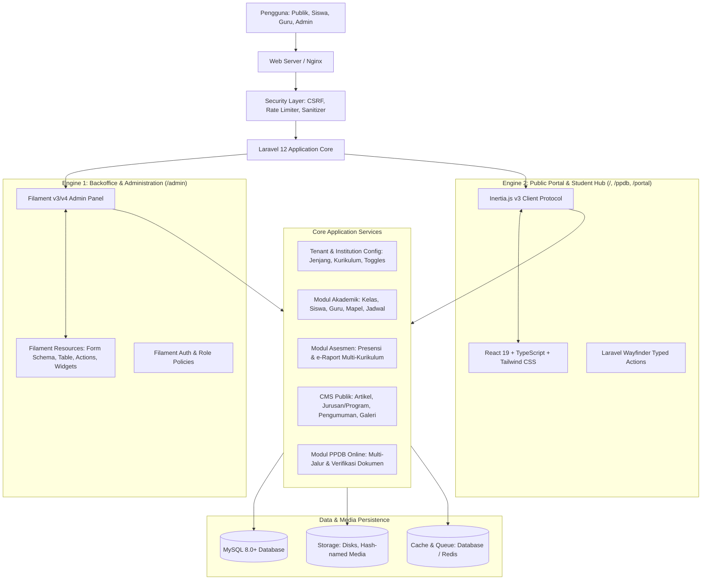
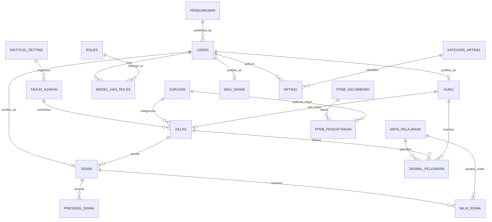

# BLUEPRINT SISTEM INFORMASI MANAJEMEN SEKOLAH & MADRASAH TERPADU (SIMAT / AKADEMI WEB)
**Dokumen Arsitektur Sistem, Desain Skema Basis Data Universal, Integrasi Filament Admin Panel, dan Roadmap Pengembangan Skalabel**

---

## 📑 Daftar Isi
1. [Ringkasan Eksekutif & Visi Universal](#1-ringkasan-eksekutif--visi-universal)
2. [Matriks Adaptabilitas Multi-Jenjang (SD/MI, SMP/MTs, SMA/MA, SMK/MAK)](#2-matriks-adaptabilitas-multi-jenjang)
3. [Arsitektur Sistem Dual-Engine (Filament Admin & React Inertia Portal)](#3-arsitektur-sistem-dual-engine)
4. [Pemodelan Basis Data & Desain ERD Universal](#4-pemodelan-basis-data--desain-erd-universal)
5. [Spesifikasi Rinci Skema & Modul Sistem](#5-spesifikasi-rinci-skema--modul-sistem)
6. [Arsitektur Filament Admin Panel (Backoffice `/admin`)](#6-arsitektur-filament-admin-panel-backoffice-admin)
7. [Protokol Keamanan, Validasi & Standarisasi Kode](#7-protokol-keamanan-validasi--standarisasi-kode)
8. [Roadmap Implementasi Bertahap (Sprint Execution Plan)](#8-roadmap-implementasi-bertahap-sprint-execution-plan)

---

## 1. Ringkasan Eksekutif & Visi Universal

Aplikasi **Akademi Web (SIMAT)** dirancang sebagai **School & Madrasah Management System** modular, komprehensif, dan siap guna (*turnkey solution*) untuk seluruh tingkat satuan pendidikan di Indonesia, baik di bawah naungan **Kemendikbudristek** maupun **Kemenag**:
- **Pendidikan Dasar**: SD (Sekolah Dasar) & MI (Madrasah Ibtidaiyah)
- **Pendidikan Menengah Pertama**: SMP (Sekolah Menengah Pertama) & MTs (Madrasah Tsanawiyah)
- **Pendidikan Menengah Atas & Kejuruan**: SMA (Sekolah Menengah Atas), MA (Madrasah Aliyah), SMK (Sekolah Menengah Kejuruan), & MAK (Madrasah Aliyah Kejuruan)

### 4 Pilar Pengguna Terintegrasi
1. **Masyarakat, Orang Tua & Calon Peserta Didik**: Portal informasi resmi, profil lembaga, direktori program/jurusan/ekstrakurikuler, galeri, berita, dan PPDB Daring (Penerimaan Peserta Didik Baru).
2. **Manajemen Lembaga & Administrator**: Pengaturan profil instansi, manajemen master data, konfigurasi kurikulum & jenjang, manajemen hak akses (RBAC), CMS konten publik, dan audit logging via **Filament Admin Panel**.
3. **Pendidik & Tenaga Kependidikan (Guru/Ustadz)**: Jurnal pengajaran harian, presensi digital kelas, asesmen formatif & sumatif, e-Raport, serta rekap capaian pembelajaran via **Filament Teacher Workspace**.
4. **Peserta Didik (Siswa/Santri) & Wali Murid**: Akses kartu hasil studi (transkrip rapor), riwayat presensi harian, agenda pengumuman, tagihan/keuangan, dan biodata induk via **React + Inertia Student Hub**.

---

## 2. Matriks Adaptabilitas Multi-Jenjang

Sistem menggunakan konfigurasi berbasis *feature toggles* dan level hierarki yang fleksibel:

| Parameter | SD / MI | SMP / MTs | SMA / MA | SMK / MAK |
| :--- | :--- | :--- | :--- | :--- |
| **Rentang Tingkat / Kelas** | Tingkat 1 s/d 6 | Tingkat 7 s/d 9 | Tingkat 10 s/d 12 | Tingkat 10 s/d 12 (atau 13) |
| **Jurusan / Peminatan** | Non-aktif (Umum) | Non-aktif (Umum) | Peminatan (IPA, IPS, Bahasa, Keagamaan) | Kompetensi Keahlian / Konsentrasi Vokasi |
| **Pengidentifikasi Lembaga** | NPSN, NSM (MI) | NPSN, NSM (MTs) | NPSN, NSM (MA) | NPSN, Bidang Industri Rekanan |
| **Nomor Induk Siswa** | NISN + NIS/NISM | NISN + NIS/NISM | NISN + NIS/NISM | NISN + NIS |
| **Nomor Pendidik** | NUPTK / NPK / NIP | NUPTK / NPK / NIP | NUPTK / NPK / NIP | NUPTK / NIP / Sertifikasi Asesor |
| **Kelompok Mapel Kemenag** | Ya (pada MI) | Ya (pada MTs) | Ya (pada MA) | Ya (pada MAK) |
| **Praktik Kerja Lapangan (PKL)** | Non-aktif | Non-aktif | Non-aktif | Aktif (Modul PKL & Industri) |

---

## 3. Arsitektur Sistem Dual-Engine

Menggabungkan kecepatan pembangunan panel pengelolaan (*Rapid Application Development*) melalui **Filament** dan interaktivitas modern portal publik melalui **React Inertia**:

### Rekomendasi Teknologi Inti:
- **Framework Backend**: Laravel 12 (PHP 8.2+) dengan arsitektur RESTful/Inertia modern.
- **Admin & Management Backoffice (`/admin`)**: **Filament PHP (v3 / v4)** (TALL Stack: Livewire, Alpine.js, Tailwind CSS) untuk CRUD cepat, dashboard statistik, bulk actions, ekspor berkas, dan filter tabel canggih.
- **Portal Publik & Siswa Hub**: **React 19**, **TypeScript**, **Tailwind CSS**, **Inertia.js v3**, **Lucide Icons**, Shadcn-UI component architecture.
- **Konektor Rute**: Laravel Wayfinder untuk pengetikan rute otomatis di TypeScript (`@/actions`, `@/routes`).
- **Database Relasional**: MySQL 8.0 / MariaDB 10.6+ / SQLite untuk lokal development.
- **AI-Assisted Engine**: Laravel Boost MCP terintegrasi untuk otomatisasi rule dan refactoring berkelanjutan.

---

## 4. Pemodelan Basis Data & Desain ERD Universal

---

## 5. Spesifikasi Rinci Skema & Modul Sistem

### 5.1 Modul Konfigurasi Institusi & Fleksibilitas Jenjang
Tabel pendukung multi-jenjang dinamis:
- **`pengaturan_institusi`**:
  - `id`
  - `nama_institusi` (contoh: *SMK Negeri 1 X*, *SMA X*, *SMP Islam Y*, *Madrasah Aliyah Z*, *SD Negeri 01 A*)
  - `jenjang` (`enum`: `'SD'`, `'MI'`, `'SMP'`, `'MTs'`, `'SMA'`, `'MA'`, `'SMK'`, `'MAK'`)
  - `npsn`, `nsm` (nomor statistik madrasah, nullable)
  - `kurikulum_aktif` (`'merdeka'`, `'k13'`, `'kombinasi'`)
  - `has_jurusan` (`boolean` - otomatis `true` untuk SMA/MA/SMK/MAK, `false` untuk SD/MI/SMP/MTs)
  - `logo`, `favicon`, `alamat`, `telepon`, `email`, `kepala_sekolah`, `nip_kepala_sekolah`
  - `fitur_ppdb` (`boolean`, default: `true`)
  - `fitur_pkl` (`boolean`, default: `false`, hanya aktif bila `jenjang` vokasi)

- **`tahun_ajaran`**:
  - `id`, `tahun` (*2026/2027*), `semester` (*Ganjil*/*Genap*), `is_active` (`boolean`).

### 5.2 Modul Master Akademik
- **`jurusan`** (Program Keahlian / Peminatan):
  - *Catatan: Digunakan sebagai kompetensi keahlian pada SMK/MAK atau jurusan peminatan (MIPA/IPS/Bahasa/Keagamaan) pada SMA/MA.*
  - `id`, `kode_jurusan`, `nama_jurusan`, `singkatan`, `deskripsi`, `visi_misi`, `prospek_kerja`, `icon`, `gambar`, `is_active`.
- **`kelas`**:
  - `id`, `tahun_ajaran_id` (FK), `jurusan_id` (FK, nullable untuk SD/SMP), `guru_id` (FK: Wali Kelas, nullable)
  - `tingkat` (angka: `1`-`6` untuk SD/MI, `7`-`9` untuk SMP/MTs, `10`-`12` untuk SMA/SMK/MA)
  - `nama_kelas` (*X TKJ 1*, *VII-A*, *V-B*, *XII MIPA 2*)
  - `kapasitas` (integer, default: 36)
- **`guru`**:
  - `id`, `user_id` (FK, nullable), `nip` (nullable), `nuptk` (nullable), `npk` (nullable)
  - `nama_lengkap`, `gelar_depan`, `gelar_belakang`, `jenis_kelamin` (`'L'`, `'P'`)
  - `bidang_studi_utama`, `telepon`, `alamat`, `foto`, `status_kepegawaian` (`'PNS'`, `'PPPK'`, `'GTT'`, `'Yayasan'`)
- **`siswa`**:
  - `id`, `user_id` (FK, nullable), `kelas_id` (FK, nullable)
  - `nis`, `nisn`, `nik`, `nama_lengkap`, `nama_panggilan`
  - `jenis_kelamin` (`'L'`, `'P'`), `tempat_lahir`, `tanggal_lahir`, `agama`
  - `alamat_lengkap`, `desa_kelurahan`, `kecamatan`, `kabupaten_kota`, `provinsi`, `kode_pos`
  - `nomor_telepon`, `email`
  - `nama_ayah`, `pekerjaan_ayah`, `nama_ibu`, `pekerjaan_ibu`, `nama_wali`, `telepon_wali`
  - `avatar`, `status` (`'aktif'`, `'lulus'`, `'pindah'`, `'drop_out'`)

### 5.3 Modul Mata Pelajaran, Jadwal & Presensi
- **`mata_pelajaran`**:
  - `id`, `kode_mapel`, `nama_mapel`, `jurusan_id` (FK nullable), `tingkat` (nullable)
  - `kelompok`:
    - *Nasional / Umum*: Pendidikan Agama, PPKn, Bahasa Indonesia, Matematika, IPA, IPS, dll.
    - *Keagamaan Kemenag*: Al-Qur'an Hadis, Akidah Akhlak, Fikih, SKI, Bahasa Arab.
    - *Peminatan*: Biologi, Fisika, Kimia, Ekonomi, Geografi, Sosiologi (SMA/MA).
    - *Kejuruan / Produktif*: Dasar Program Keahlian, Konsentrasi Keahlian (SMK/MAK).
    - *Muatan Lokal*: Bahasa Daerah, Seni Budaya, Prakarya.
  - `kkm_atau_kktp` (Kriteria Ketercapaian Tujuan Pembelajaran, default: 75).
- **`jadwal_pelajaran`**:
  - `id`, `kelas_id` (FK), `mapel_id` (FK), `guru_id` (FK), `hari` (`'Senin'`..`'Sabtu'`), `jam_mulai`, `jam_selesai`.
- **`presensi_siswa`**:
  - `id`, `siswa_id` (FK), `kelas_id` (FK), `tanggal`, `status` (`'Hadir'`, `'Sakit'`, `'Izin'`, `'Alpa'`), `catatan`, `diverifikasi_oleh` (user_id).
- **`nilai_siswa`**:
  - Kompatibel Kurikulum Merdeka & K13:
  - `id`, `siswa_id` (FK), `mapel_id` (FK), `tahun_ajaran_id` (FK)
  - `nilai_formatif` (rata-rata tugas/asesmen berkala)
  - `nilai_uts_sts` (Sumatif Tengah Semester)
  - `nilai_uas_sas` (Sumatif Akhir Semester)
  - `nilai_akhir` (angka terhitung berbobot)
  - `capaian_kompetensi` (deskripsi naratif untuk e-raport Kurikulum Merdeka)

### 5.4 Modul Publik & CMS Sekolah (Portal Web)
- **`kategori_artikel`**: `id`, `nama_kategori`, `slug`.
- **`artikel`**: `id`, `user_id` (penulis), `kategori_id` (FK), `judul`, `slug`, `ringkasan`, `konten`, `thumbnail`, `status` (`'draft'`, `'published'`), `views_count`, `published_at`.
- **`pengumuman`**: `id`, `judul`, `slug`, `isi_pengumuman`, `lampiran_file`, `target_penerima` (`'semua'`, `'siswa'`, `'guru'`, `'wali'`), `is_urgent`, `tanggal_kadaluarsa`.
- **`galeri_kegiatan`**: `id`, `judul`, `kategori`, `media_url`, `deskripsi`, `tanggal_kegiatan`.
- **`prestasi_sekolah`**: `id`, `judul_prestasi`, `kategori` (*Akademik / Non-Akademik*), `tingkat` (*Kecamatan, Kabupaten, Provinsi, Nasional, Internasional*), `peraih` (*Siswa / Guru / Sekolah*), `foto`, `tahun`.

### 5.5 Modul PPDB (Penerimaan Peserta Didik Baru) Daring
- **`ppdb_gelombang`**:
  - `id`, `tahun_ajaran_id` (FK), `nama_gelombang` (*Jalur Afirmasi, Zonasi, Prestasi, Reguler*), `tanggal_buka`, `tanggal_tutup`, `is_active`.
- **`ppdb_pendaftaran`**:
  - `id`, `gelombang_id` (FK), `nomor_pendaftaran` (unik, e.g., *PPDB-2026-0001*)
  - `nisn`, `nik`, `nama_calon_siswa`, `jenis_kelamin`, `tempat_lahir`, `tanggal_lahir`, `asal_sekolah`
  - `jurusan_pilihan_1` (FK nullable, untuk SMA/SMK/MA)
  - `jurusan_pilihan_2` (FK nullable, cadangan jika kuota penuh)
  - `jalur_pendaftaran` (`'zonasi'`, `'afirmasi'`, `'prestasi'`, `'perpindahan_ortu'`, `'reguler'`, `'tes'`)
  - `nama_wali`, `nomor_whatsapp_wali`, `alamat`
  - `berkas_kartu_keluarga`, `berkas_akta_kelahiran`, `berkas_ijazah_skl`, `berkas_rapor_prestasi`
  - `status_seleksi` (`'menunggu_verifikasi'`, `'berkas_sesuai'`, `'perlu_perbaikan'`, `'diterima'`, `'tidak_diterima'`)
  - `catatan_panitia`, `diverifikasi_oleh` (user_id).

---

## 6. Arsitektur Filament Admin Panel (Backoffice `/admin`)

Panel admin dibangun menggunakan **Filament v3/v4** untuk menyediakan antarmuka manajemen berbasis peran yang rapi, cepat, dan kaya fitur:

### 6.1 Daftar Filament Resources
1. **Pengaturan Lembaga**:
   - `ManageInstitutionSettings` (Custom Settings Page / Single Record Resource): Pengaturan nama, jenjang, kurikulum aktif, logo, kontak, dan toggle fitur.
   - `AcademicYearResource` (`TahunAjaran`): Kelola tahun ajaran & semester aktif.
2. **Master Data Akademik**:
   - `MajorResource` (`Jurusan`): Tampil kondisional di navigasi hanya jika `has_jurusan = true`.
   - `ClassroomResource` (`Kelas`): Manajemen kelas, filter per tingkat (1-6, 7-9, 10-12), penetapan wali kelas.
   - `TeacherResource` (`Guru`): Data pendidik, NIP/NUPTK/NPK, bidang studi, status kepegawaian.
   - `StudentResource` (`Siswa`): Data siswa, import/export Excel, avatar, filter kelas, aksi mutasi siswa.
3. **Pembelajaran & Asesmen**:
   - `SubjectResource` (`MataPelajaran`): Pengelompokan mapel (Umum, Kemenag, Kejuruan, Mulok).
   - `ScheduleResource` (`JadwalPelajaran`): Jadwal KBM mingguan per kelas.
   - `AttendanceResource` (`PresensiSiswa`): Input presensi massal per tanggal & kelas dengan badge status.
   - `GradeResource` (`NilaiSiswa`): Matrix input nilai formatif/sumatif, perhitungan otomatis nilai akhir, dan tombol aksi "Cetak Rapor Siswa (PDF)".
4. **Warta & Publikasi (CMS)**:
   - `ArticleResource` (`Artikel`): Editor rich-text, thumbnail upload, manajemen tag/kategori, status draft/publish.
   - `AnnouncementResource` (`Pengumuman`): Pengumuman urgensi, berkas lampiran, target audiens.
   - `GalleryResource` (`GaleriKegiatan`): Unggah foto multi-media kegiatan sekolah.
   - `AchievementResource` (`PrestasiSekolah`): Pencatatan prestasi akademik/non-akademik.
5. **Penerimaan Siswa Baru (PPDB)**:
   - `PpdbWaveResource` (`PpdbGelombang`): Atur jadwal buka/tutup gelombang pendaftaran.
   - `PpdbApplicantResource` (`PpdbPendaftaran`):
     - Tabel calon pendaftar dengan filter jalur & status seleksi.
     - Pratinjau berkas pendaftaran (Ijazah, KK, Akta) langsung dalam modal dialog.
     - Action tombol cepat: "Verifikasi Berkas", "Terima Calon Siswa", "Tolak / Minta Revisi".
     - Ekspor data calon siswa ke Excel/CSV untuk rekapitulasi dinas.

### 6.2 Widget & Dashboard Statistik Filament
- `InstitutionOverviewWidget`: Stat jumlah total siswa aktif, total guru, rombongan belajar (kelas), dan pendaftar PPDB.
- `AttendanceChartWidget`: Grafik tren kehadiran harian/bulanan.
- `PpdbSummaryWidget`: Rasio pendaftar per jalur dan kuota daya tampung.

---

## 7. Protokol Keamanan, Validasi & Standarisasi Kode

### 7.1 Upload & File Sanitization
- Berkas publik (avatar, thumbnail warta) dan berkas privat (dokumen pendaftar PPDB: KK, Akta, Ijazah) disimpan di disk terpisah:
  - Berkas rahasia/identitas PPDB di disk `private` / storage non-publik dengan validasi hak akses melalui rute controller / Filament Action terotentikasi.
  - Nama berkas di-hash secara acak (`Str::uuid()` atau `hash_hmac`).
  - Validasi MIME-type ketat: `image/jpeg,image/png,image/webp` untuk foto (maks 2MB) dan `application/pdf` untuk berkas dokumen PPDB (maks 3MB).

### 7.2 Standarisasi RESTful & Proteksi CSRF
- Tidak ada operasi manipulasi/penghapusan data via HTTP GET.
- Seluruh mutasi data menggunakan method POST, PUT/PATCH, dan DELETE dengan verifikasi token CSRF bawaan Laravel.
- Gunakan Form Request khusus (`InstitutionConfigRequest`, `SiswaStoreRequest`, `PpdbRegistrationRequest`) dengan aturan sanitasi input.

### 7.3 Hak Akses Berbasis Peran (RBAC)
- Peran baku (Spatie Permission / Filament Shield):
  1. `super-admin`: Hak penuh ke seluruh resource, backup, log, dan manajemen pengguna.
  2. `admin-sekolah`: Manajemen master data, kurikulum, dan CMS publik.
  3. `guru`: Akses panel pengisian presensi, agenda mengajar, dan penginputan nilai kelas binaan.
  4. `panitia-ppdb`: Akses khusus verifikasi berkas pendaftar dan validasi kelulusan calon siswa.
  5. `siswa`: Akses portal siswa (rapor pribadi, riwayat presensi).
  6. `wali-murid`: Pemantauan kehadiran dan nilai anak.

---

## 8. Roadmap Implementasi Bertahap (Sprint Execution Plan)

### Sprint 1: Setup Filament Admin Panel & Konfigurasi Multi-Jenjang
- [x] Instalasi paket Filament (`composer require filament/filament`).
- [x] Setup `AdminPanelProvider` dengan path `/admin`, custom branding (logo, title dinamis), dan tema warna.
- [x] Migrasi tabel `pengaturan_institusi`, `tahun_ajaran`, dan seeding profil instansi awal.
- [x] Buat `ManageInstitutionSettings` & `AcademicYearResource` di Filament:
  - [x] Pemilihan jenjang (SD/MI/SMP/MTs/SMA/MA/SMK/MAK) dan kurikulum aktif.
  - [x] Toggle adaptif: Navigasi `Jurusan` otomatis disembunyikan jika `has_jurusan = false`.

### Sprint 2: Master Akademik via Filament Resources
- [ ] Migrasi & Model `jurusan`, `kelas`, `guru`, `siswa` dengan relasi lengkap dan foreign key integrity.
- [ ] Pembuatan `MajorResource` (hanya aktif jika jenjang menengah/kejuruan).
- [ ] Pembuatan `ClassroomResource` (adaptif tingkat 1-6 untuk SD/MI, 7-9 untuk SMP/MTs, 10-12 untuk SMA/SMK/MA).
- [ ] Pembuatan `TeacherResource` (form data diri, NIP/NUPTK/NPK, bidang studi).
- [ ] Pembuatan `StudentResource` (form biodata lengkap, filter per kelas/tingkat, ekspor data, upload avatar).

### Sprint 3: Modul Asesmen & Presensi via Filament
- [ ] Migrasi `mata_pelajaran`, `jadwal_pelajaran`, `presensi_siswa`, `nilai_siswa`.
- [ ] Pembuatan `SubjectResource` (pengelompokan mapel Nasional, Kemenag, Peminatan, Kejuruan, Mulok).
- [ ] Pembuatan `AttendanceResource` (input presensi harian per kelas, badge kehadiran).
- [ ] Pembuatan `GradeResource` (input nilai formatif/sumatif Kurikulum Merdeka & K13).
- [ ] Fitur Cetak Rapor / Transkrip Hasil Belajar format PDF.

### Sprint 4: Portal CMS & Informasi Publik
- [ ] Pembuatan `ArticleResource`, `AnnouncementResource`, `GalleryResource`, `AchievementResource` di Filament.
- [ ] Portal publik berbasis React Inertia (`/`, `/profil`, `/berita`, `/pengumuman`, `/galeri`):
  - Tampilan beranda profil lembaga adaptif (sejarah, visi-misi, pimpinan, kontak).
  - Tampilan daftar jurusan/peminatan (otomatis menyesuaikan jenjang yang diset di Filament).

### Sprint 5: Modul PPDB Daring Multi-Jalur
- [ ] Skema database `ppdb_gelombang` dan `ppdb_pendaftaran`.
- [ ] `PpdbWaveResource` & `PpdbApplicantResource` di Filament:
  - Tabel pendaftar dengan filter jalur & status verifikasi.
  - Modal pratinjau berkas dokumen (Ijazah, KK, Akta) & aksi verifikasi satu klik.
- [ ] Portal publik PPDB berbasis React Inertia:
  - Formulir pendaftaran multi-step (`/ppdb/daftar`) dengan validasi NISN dan upload berkas.
  - Halaman cek status pendaftaran mandiri (`/ppdb/cek-status`) & cetak bukti pendaftaran resmi.

---

*Cetak biru ini menjadi standar arsitektur tunggal pengembangan aplikasi Sistem Informasi Manajemen Sekolah & Madrasah (Akademi Web).*
